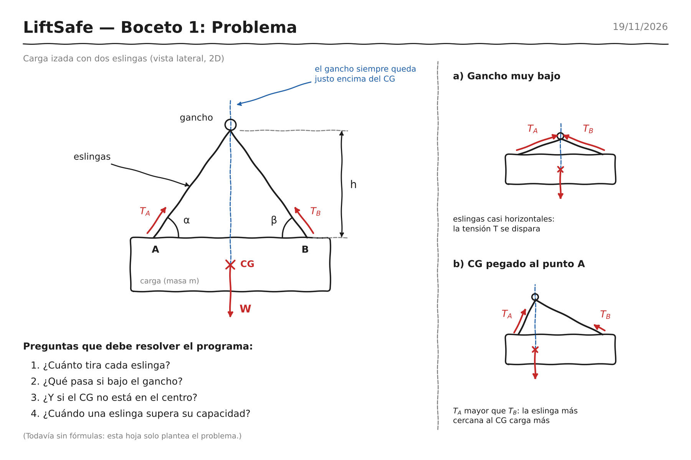
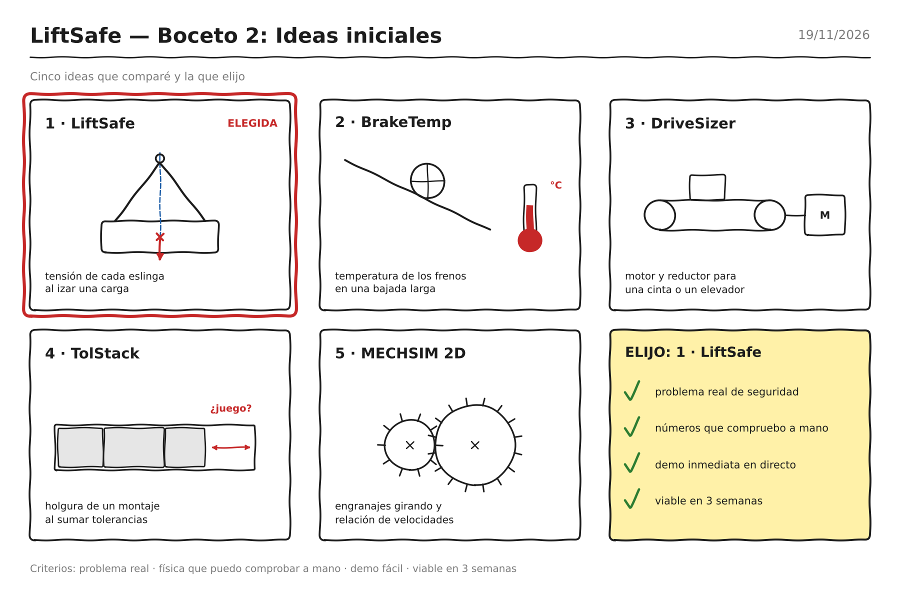
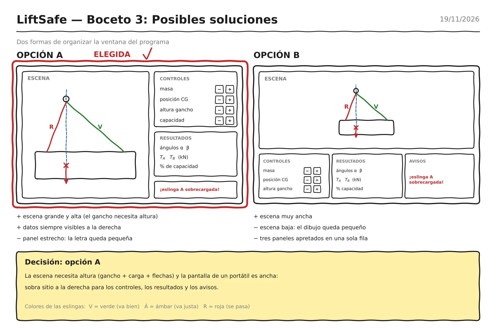
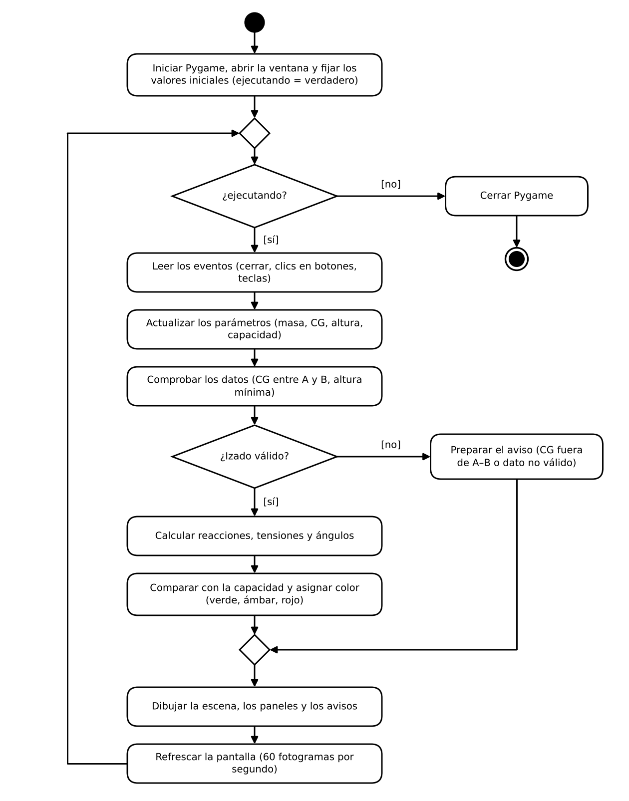
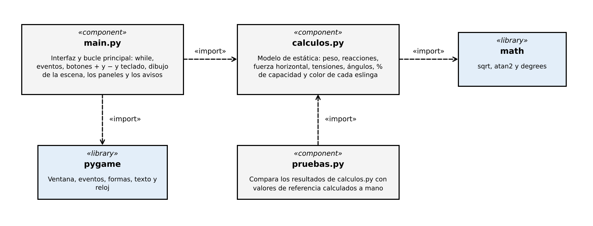

# LiftSafe

**Simulador didáctico de izado de cargas con dos eslingas**

Proyecto extra voluntario · Fundamentos de Informática · Grado en Ingeniería Mecánica · Universidad de Oviedo · Curso 2026–2027

- **Autor:** Hugo Novo
- **Repositorio:** <https://github.com/hugo542314/LiftSafe>
- **Estado:** en desarrollo (fase de diseño). Las secciones marcadas como *pendiente* se completarán a medida que avance el programa.

---

## 1. Problema

Al izar una carga con un gancho y dos eslingas, la tensión que soporta cada eslinga no es evidente. Depende del peso, de la posición del centro de gravedad (CG), de la posición de los puntos de izado y de la altura del gancho. Si el gancho queda bajo, las eslingas se acercan a la horizontal y su tensión crece mucho. Si el CG está cerca de uno de los puntos de izado, esa eslinga carga más que la otra. Una mala estimación puede sobrecargar una eslinga.

LiftSafe permite variar esos datos y ver al instante la tensión de cada eslinga frente a su capacidad.

## 2. Objetivos

**Objetivo general.** Desarrollar en Python 3, con gráficos 2D en Pygame, una herramienta didáctica que calcule y represente la tensión de cada eslinga en un izado estático con dos eslingas.

**Objetivos específicos.**

1. Calcular reacciones, tensiones y ángulos con fórmulas de estática que se puedan comprobar a mano.
2. Representar la maniobra en 2D y permitir modificar la masa, la posición del CG, la altura del gancho y la capacidad de las eslingas.
3. Avisar cuando el izado no es válido o cuando una eslinga supera su capacidad.
4. Mostrar cómo varía la tensión con el ángulo de las eslingas.
5. Entregar una versión funcional que pueda ejecutarse desde cero siguiendo estas instrucciones.

## 3. Funcionalidades

*Alcance previsto. Pendiente de implementar: se actualizará con lo que realmente quede terminado.*

**Versión 1.0**

- Escena 2D con la carga, el CG, los puntos de izado A y B, el gancho y las dos eslingas.
- Botones + y − (y teclado) para la masa, la posición del CG, la altura del gancho y la capacidad de las eslingas (la misma para las dos).
- Resultados en tiempo real: ángulos, tensiones en kN y porcentaje de capacidad.
- Eslingas coloreadas (verde, ámbar o rojo según su nivel de carga) y avisos: CG fuera de los puntos de izado y eslinga sobrecargada.

**Versión 1.1**

- Curva tensión–ángulo con el punto de trabajo actual marcado.

## 4. Diseño

### 4.1 Bocetos iniciales

#### Boceto 1: planteamiento del problema



Se formula un modelo bidimensional (vista lateral) para analizar el izado estático de una carga de masa `m` y peso `W`, suspendida de un gancho mediante dos eslingas ancladas en los puntos A y B. Por equilibrio, el sistema se alinea de modo que la vertical del gancho pasa por el centro de gravedad (CG) de la carga. A partir de esta configuración, el boceto identifica dos situaciones críticas en maniobras reales:

- **Altura de gancho reducida (`h` baja):** al bajar demasiado el gancho, las eslingas quedan casi horizontales (ángulos α y β muy pequeños) y las tensiones `T_A` y `T_B` se disparan.
- **Excentricidad del CG:** cuando el CG se desplaza hacia un extremo (por ejemplo, cerca de A), se rompe la simetría del reparto y la eslinga más cercana al CG soporta una parte mucho mayor del peso (`T_A` > `T_B`).

Para resolverlo, el programa debe responder a cuatro cuestiones:

1. **Cálculo de tensiones:** determinar el esfuerzo que soporta cada eslinga (`T_A` y `T_B`).
2. **Sensibilidad a la altura:** evaluar cómo aumentan las tensiones al disminuir la altura `h` del gancho.
3. **Asimetría:** calcular el desequilibrio de cargas entre las dos eslingas cuando el CG no coincide con el punto medio entre A y B.
4. **Verificación de seguridad:** determinar cuándo una eslinga supera su capacidad máxima admisible.

#### Boceto 2: elección de LiftSafe frente a las alternativas



LiftSafe se eligió frente a las otras cuatro ideas evaluadas (BrakeTemp: temperatura de los frenos en una bajada larga; DriveSizer: motor y reductor para una cinta o un elevador; TolStack: holgura de un montaje al sumar tolerancias; MECHSIM 2D: engranajes y relación de velocidades) con cuatro criterios:

- **Problema real de seguridad:** aborda una necesidad real del izado de cargas y de la prevención de accidentes, lo que da al proyecto una aplicación práctica.
- **Física comprobable a mano:** el modelo estático de equilibrio de fuerzas permite verificar con cálculos propios los resultados del programa. El cálculo de tensiones no depende de tablas empíricas: la capacidad de cada eslinga es un dato que introduce el usuario.
- **Demostración inmediata en directo:** al ser visual, permite mostrar en tiempo real cómo cambian las tensiones y el estado de las eslingas al variar los parámetros.
- **Viable en tres semanas:** el alcance es realista para implementar el cálculo, la interfaz y las pruebas en el plazo disponible.

#### Boceto 3: elección de la distribución de la ventana



Se eligió la opción A frente a la B por ergonomía visual, aprovechamiento de la pantalla y coherencia con la geometría del sistema:

- **Prioridad a la altura de la escena:** representar un izado exige altura para ver a buena escala el gancho, la inclinación de las eslingas, la carga y los vectores de fuerza. La opción A dedica toda la altura de la ventana a la escena; la B la comprime en una franja superior y el dibujo queda pequeño.
- **Adecuación a pantallas anchas:** las pantallas de portátil son anchas, así que la escena a la izquierda deja espacio a la derecha para apilar los controles (masa, posición del CG, altura del gancho y capacidad), los resultados (ángulos α y β, tensiones `T_A` y `T_B` en kN y porcentaje de capacidad) y los avisos de sobrecarga.
- **Claridad frente a saturación:** la opción B reúne tres bloques apretados en una sola fila. La A mantiene los datos y las alertas siempre visibles a la derecha, junto al código de colores de las eslingas (verde, ámbar y rojo según su nivel de carga). El único compromiso asumido es un panel lateral más estrecho, con letra algo más pequeña.

### 4.2 Diagramas UML

Los diagramas se hicieron antes de programar y se revisarán al terminar para que coincidan con el código. Sus archivos editables, en formato `.drawio`, están en `docs/diagramas/`.

**Diagrama de actividades (funcionamiento).** Describe lo que hace el programa en cada vuelta del bucle principal: leer los eventos, actualizar los parámetros, comprobar que el izado es válido, calcular las tensiones y compararlas con la capacidad, dibujar y refrescar la pantalla. El bucle se repite mientras la variable `ejecutando` sea verdadera.



**Diagrama de componentes (estructura).** Muestra cómo se organiza el código. `main.py` (interfaz) usa `calculos.py` (modelo de estática) y la biblioteca `pygame`; `calculos.py` usa `math`; `pruebas.py` comprueba `calculos.py`. Así el cálculo físico queda separado del dibujo.



### 4.3 Modelo de cálculo

Hipótesis del modelo: sistema 2D y estático; el gancho queda en la vertical del CG (condición de equilibrio); la carga se mantiene horizontal; las eslingas son rectas, sin peso propio y con la longitud necesaria en cada caso.

```
Datos de entrada:  m (kg) · x_A, x_B, x_G (m) · h (m) · capacidad (kN)
Peso:              W = m · g                  con g = 9,81 m/s²
Distancias:        d_A = x_G − x_A     d_B = x_B − x_G     L = x_B − x_A
Verticales:        V_A = W · d_B / L   V_B = W · d_A / L
Horizontal:        H = W · d_A · d_B / (h · L)
Tensiones:         T_A = √(H² + V_A²)  T_B = √(H² + V_B²)
Ángulos:           α = atan(h / d_A)   β = atan(h / d_B)     (con la horizontal)
Uso de capacidad:  porcentaje = T / capacidad · 100
Izado válido si:   x_A ≤ x_G ≤ x_B, x_A < x_B y h > 0
```

`V_A` y `V_B` salen del equilibrio de momentos (regla de la palanca) y `H`, del equilibrio horizontal. En el caso simétrico (`d_A = d_B = L/2`) resulta `T = (W/2) / sen α`, que se comprueba a mano.

### 4.4 Decisiones tomadas

- **Lenguaje y gráficos:** Python 3 con Pygame para los gráficos 2D, como permite el pliego.
- **Diseño por funciones, sin clases:** las clases todavía no se han estudiado en la asignatura.
- **Cálculo separado del dibujo:** `calculos.py` no usa Pygame; `main.py` se ocupa de la ventana. Así el cálculo se puede probar por separado.
- **Unidades:** el cálculo trabaja en unidades del SI (kg, m, N); los resultados se muestran en kN y en porcentaje.
- **Interfaz:** botones + y − dibujados con Pygame y atajos de teclado.
- **Elección del proyecto y de la distribución de la ventana:** ver los bocetos 2 y 3.

## 5. Instrucciones de ejecución

*Pendiente de verificar cuando exista el programa.*

Requisitos: Python 3.12 o 3.13 (64 bits) y Git. La biblioteca Pygame 2.6.1 se instaló e importó correctamente con Python 3.12.10 en Windows.

**Windows (PowerShell)**

```
git clone https://github.com/hugo542314/LiftSafe.git
cd LiftSafe
py -3.12 -m venv .venv
.\.venv\Scripts\python -m pip install -r requirements.txt
.\.venv\Scripts\python src\main.py
```

**Linux o macOS**

```
git clone https://github.com/hugo542314/LiftSafe.git
cd LiftSafe
python3 -m venv .venv
.venv/bin/python -m pip install -r requirements.txt
.venv/bin/python src/main.py
```

## 6. Pruebas realizadas

*Pendiente. La tabla recoge valores de referencia calculados con un script independiente del programa; se compararán con los resultados de LiftSafe cuando exista.*

| Caso | Datos | `T_A` (kN) | `T_B` (kN) | α / β |
|---|---|---|---|---|
| 1. CG centrado | m = 2000 kg; x_A = 0; x_B = 2 m; x_G = 1 m; h = 1 m | 13,873 | 13,873 | 45° / 45° |
| 2. CG cerca de A | m = 2000 kg; x_A = 0; x_B = 2 m; x_G = 0,5 m; h = 1 m | 16,452 | 8,843 | 63,43° / 33,69° |
| 3. Simétrico a 30° | m = 1000 kg; x_A = 0; x_B = 2 m; x_G = 1 m; h = 0,577 m | 9,810 | 9,810 | 30° / 30° |
| 4. Simétrico a 60° | m = 1000 kg; x_A = 0; x_B = 2 m; x_G = 1 m; h = 1,732 m | 5,664 | 5,664 | 60° / 60° |

En el caso 3 cada eslinga soporta el peso entero (W = 9,810 kN).

## 7. Limitaciones conocidas

- Es una herramienta didáctica: no sustituye el plan de izado de una persona competente.
- El modelo es 2D y estático, con solo dos eslingas.
- La carga se mantiene horizontal y las eslingas se consideran ajustables: la longitud de la eslinga no es un dato del problema.
- El gancho se coloca siempre en la vertical del CG.
- No incluye factores de modo de uso ni coeficientes de seguridad normativos. La capacidad de las eslingas la introduce el usuario.
- Los umbrales de aviso son criterios de diseño del programa, no valores normativos (pendiente de concretar y, si procede, citar una fuente).
- *Pendiente: añadir las limitaciones que aparezcan al programar y probar.*

## 8. Fuentes y materiales externos

- Python 3 y su biblioteca estándar (`math`): <https://www.python.org>
- Pygame 2.6.1, instalada con `pip`: <https://www.pygame.org>
- Material de la asignatura Fundamentos de Informática (Universidad de Oviedo): guía «Sacaveras en Travesera», cuadernos de Python 01–05 y apuntes de 2019-20.
- Fórmulas de estática: *pendiente de indicar el libro o los apuntes de Física o Mecánica con los que se contrastan.*
- Herramientas de diagramación: diagrams.net (formato `.drawio`).
- Asistente de IA Claude (Anthropic), con autorización del profesor: apoyo en el diseño, el código y la redacción de la documentación. Los bocetos digitales se generaron con un script de Python (matplotlib) con su ayuda.

## 9. Autoría

Hugo Novo, estudiante de primer curso del Grado en Ingeniería Mecánica (Universidad de Oviedo).

## 10. Enlace al repositorio

<https://github.com/hugo542314/LiftSafe>
